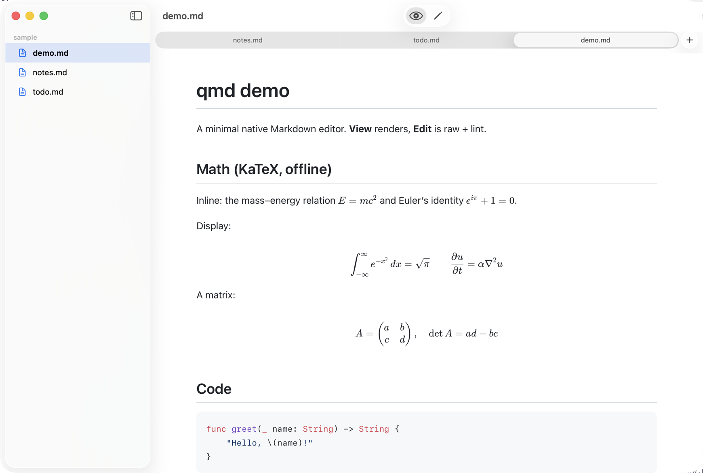
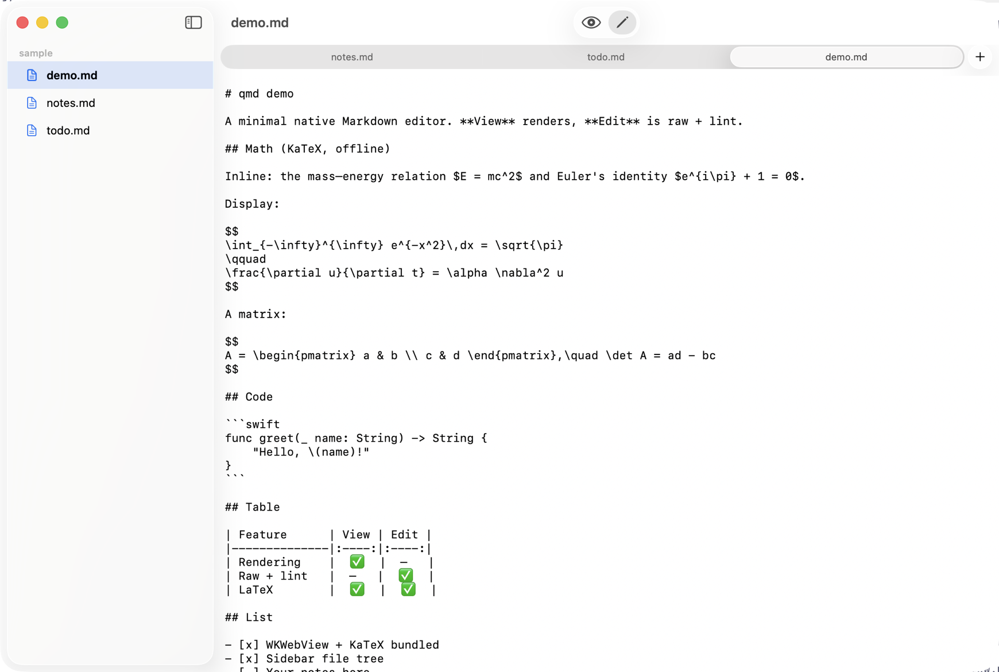

[English](README.en.md)

# MapleDown

**轻量的 Mac Markdown 应用。页面本身就是界面。**

打开就能读。想改原文时按 `⌘E`。除此之外，不再有东西来抢注意力。

 

---

MapleDown 是原生 Mac 应用。文件留在本机，不需要登录，渲染页面也不联网。公式、表格和代码都在本地画出来。窗口会记住大小，浅色和深色跟随系统。

什么都没打开就启动时，只有两个选择：新建一篇 Markdown，或打开已有的一篇。打开文件后，页面来到前面；关闭最后一个文档，会回到这个初始页。

| 阅读 | 写作 |
| :---: | :---: |
|  |  |

**预览**就是文档本身：标题、公式、表格、任务列表、代码高亮，以及阅读时间。**编辑**是原文。Markdown 提示平时不打扰，也可以在“显示”菜单里关掉。

侧边栏是你正在看的那个文件夹。点击 Markdown 文件就在这里打开；同一文件夹里的文件成为标签，别的文件夹则开一个新窗口。其他类型的文件先停在列表里，双击才交给它们自己的应用。文件列表下面，大纲跟着你正在读的章节。`⌃⌥↑` 和 `⌃⌥↓` 在标题之间移动。

在访达里选中 `.md`，按 <kbd>空格</kbd>。Quick Look 会显示同一份渲染后的页面，公式也在其中。

## 安装

需要 macOS 14（Sonoma）或更高版本。

从 **[Releases](https://github.com/zzzyx28/mapledown/releases)** 下载最新的 `.dmg`，打开后把 MapleDown 拖进“应用程序”。

这个下载未经 Apple 公证。若 macOS 首次拦截，请按住 Control 点按 MapleDown 并选择**打开**，或在**系统设置 → 隐私与安全性**中允许。

打开一次 MapleDown，Quick Look 才会注册。若要把它设为 Markdown 的默认应用：右键任意 `.md` → **显示简介** → **打开方式** → **MapleDown** → **全部更改…**

卸载时，从“应用程序”中删除 MapleDown。如果曾设为默认应用，再在 `.md` 的“打开方式”里改回来。

## 快捷键

| | |
|---|---|
| 预览 / 编辑 | `⌘E` |
| 显示或隐藏侧边栏 | `⌘\` |
| 上一个 / 下一个标题 | `⌃⌥↑` / `⌃⌥↓` |
| 大纲 | `⌃⌘1` |
| 下一个 / 上一个标签 | `⌘⌥→` / `⌘⌥←` |
| 跳到某个标签 | `⌘1` … `⌘9` |
| 在下方 / 上方新开一行 | `⌘↩` / `⇧⌘↩` |
| 移动 / 复制一行 | `⌥↑` `⌥↓` / `⌥⇧↑` `⌥⇧↓` |
| 删除一行 | `⇧⌘K` |
| 注释或取消注释 | `⌘/` |

## 许可

[MIT](LICENSE) © 2026 Zhengyx。MapleDown 衍生自 yeduk3 的 [Glim](https://github.com/yeduk3/Glim)，同样为 MIT。第三方声明见 [THIRD_PARTY_NOTICES.md](THIRD_PARTY_NOTICES.md)。
